 

### Software Engineer · Full-Stack Developer · Creative Technologist

*Turning ideas into thoughtful digital experiences.*

[Portfolio](https://pabitraswain.in) · [Facebook](https://www.facebook.com/PABITRASWAIN.IN) · [Instagram](https://www.instagram.com/PABITRASWAIN.IN)

---

My **About **, 

 ## Experience

**Web Application Developer — Atreya Associates** · 2022–Present  
Resume-listed work includes web application development, API integration, responsive interfaces, and performance optimization.

**UI/UX Designer & Web Developer — Ad Your Dream Pvt. Ltd.** · 2021–2022  
Resume-listed work includes responsive website design and modern UI implementation.

**Freelance Front-End Developer** · 2020–Present  
Resume-listed work includes custom websites and WordPress solutions.

## Education

**Bachelor of Computer Applications (BCA)**  
Presidency College, Berhampur · 2016–2019

> Additional specialization, CGPA, and competition achievements are intentionally omitted until supporting evidence is verified.

## Skills

The skills below are taken from the available resume.

| Category | Technologies and capabilities |
| --- | --- |
| Front-end | HTML5, CSS3, JavaScript |
| UI and responsive design | Responsive Web Design, UI/UX Design, Bootstrap |
| JavaScript and integration | jQuery, AJAX, REST API Integration |
| CMS | WordPress |
| Professional strengths | Problem Solving, Team Collaboration |

## Selected Work

This section is deliberately conservative: the supplied materials available for this README did not establish public repository URLs or live demo URLs for individual projects. Add a project only when its repository or demo is confirmed.

<!--
When you have verified project links, use this structure:

### Project Name
One or two sentences describing what the project actually does.
- **Built with:** only technologies used in that repository
- **Repository:** https://github.com/YOUR-USERNAME/PROJECT-REPOSITORY
- **Live demo:** https://your-verified-demo.example
-->

## Certifications & Achievements

No certification or competition result is listed here because verifiable supporting evidence was not available in the supplied resume.

If you provide certificates or official result pages, this section can include confirmed entries such as competition placements, course certificates, and professional credentials.

## GitHub Activity

GitHub contribution data is tied to the exact GitHub username. To avoid showing another person's activity or a broken chart, no third-party statistics card is embedded until the profile username is confirmed.

Once your username is confirmed, a genuine contribution graph can be added using a reputable service or a maintained workflow. Any generated or illustrative data should be clearly labelled and never presented as actual activity.

## Find Me Online

- **Website:** [pabitraswain.in](https://pabitraswain.in)
- **Facebook:** [PABITRASWAIN.IN](https://www.facebook.com/PABITRASWAIN.IN)
- **Instagram:** [@PABITRASWAIN.IN](https://www.instagram.com/PABITRASWAIN.IN)

> Professional profiles such as GitHub, LinkedIn, LeetCode, and HackerRank can be added after their exact URLs are confirmed.

---

  
  Designed with care · Built to keep evolving

